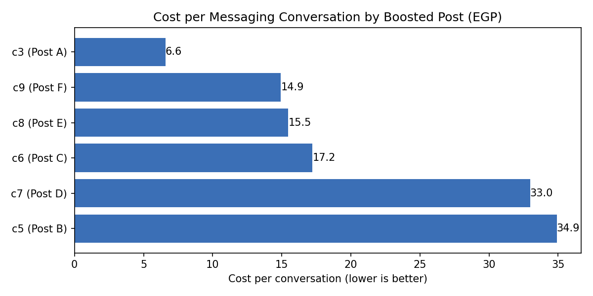

# Which Boosted Posts Brought Cheaper Messages?

Analysis of 9 boosted-post campaigns from a real Meta Ads account (acting workshops, names anonymized). 6 campaigns aimed at messaging conversations and 3 at post engagement.

## Question
Which boosted posts brought messaging conversations at the lowest cost?

## What I did
- Split campaigns by goal (messaging vs engagement) so different results are not mixed
- Calculated cost per conversation = amount spent / conversations
- Compared each campaign's share of spend with its share of conversations

## Findings
1. Two campaigns (c8, c9) took 57% of the messaging budget and brought 62% of conversations, at about 15 EGP each.
2. Two campaigns (c5, c7) took 24% of the budget and brought 12% of conversations, at 33-35 EGP each.
3. c3 had the lowest cost (6.6 EGP) but spent only 98 EGP and brought 15 conversations, so it needs a bigger test.

## Recommendation
Keep budget on c8 and c9, reduce c5 and c7, and test c3 with a larger budget before scaling.

## Limitations
- Only 6 messaging campaigns, with 6 to 32 conversations each. Differences are signals, not proof.
- The export has no campaign start dates, so I could not compare over time.
- Engagement campaigns were excluded because their result is a different action.

Tools: Python, Pandas, Matplotlib (Google Colab)
